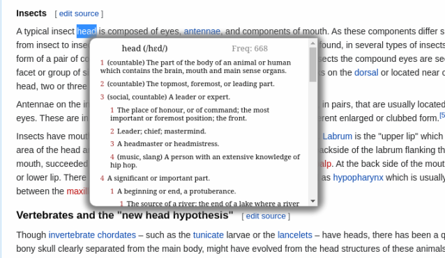
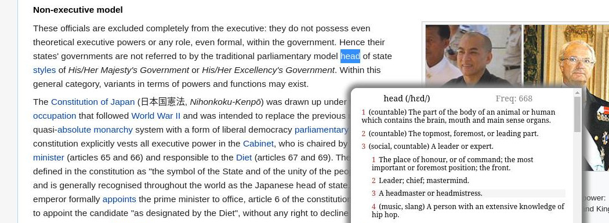
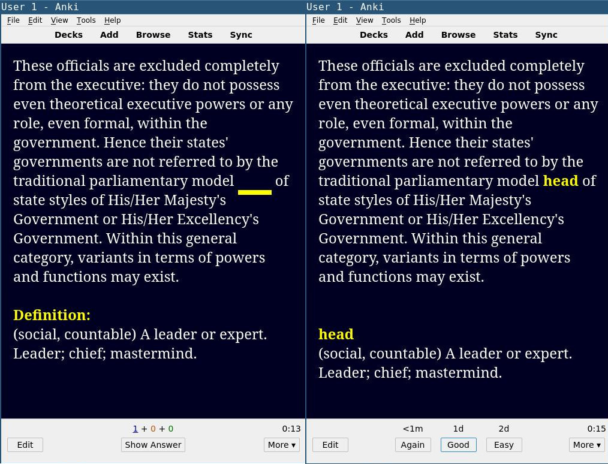
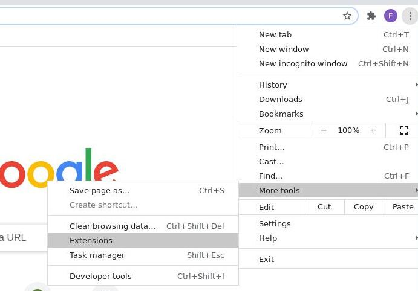
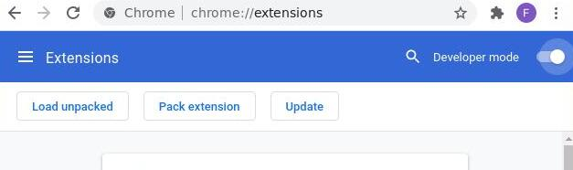

# Minerva Popup Dictionary

Minerva Popup Dictionary (MPD) is an extension for Chrome that lets users search for the meanings of a word by clicking on it.

<p align="left">
  
</p>


## Features
Minerva Popup Dictionary:
- works offline.
- includes the frequency of each word.
- includes the IPA transcription of each word based on Standard British English (Received Pronunciation).
- supports searching within the popup window.
- supports automatic creation of cloze cards on Anki.
- can generate easier, textbook-style example phrases with the DeepSeek API (optional).

<p align="left">
  
</p>
<p align="left">
  
</p>


## Dictionary Files
The dictionary files were obtained from Wiktionary by using [this parser](https://github.com/farleyoli/wiktionary-parser), written by the same author of this repository.

## Installation
To install MPD, first clone (or download) this repository to any location in your computer. To do this, open your terminal, and type the following.

```sh
git clone https://github.com/farleyoli/minerva-popup-dictionary
```

Then go to `More tools` followed by `Extensions` in the Chrome options menu.

<p align="left">
  
</p>

After enabling developer mode, click the `Load unpacked` button and select the directory where you have cloned the MPD repository.

<p align="left">
  
</p>

Congratulations! You are ready to start using MPD. Try double clicking any word in your browser.

## DeepSeek-generated example phrases (optional)
By default, cards use the phrase captured from the page. To study with an easier, textbook-style passage instead:

1. Open the extension options (right-click the extension → `Options`).
2. Set `Card type` to `DeepSeek AI phrase`.
3. Paste a [DeepSeek API key](https://platform.deepseek.com/) into the `DeepSeek API key` field and save.
4. Optionally adjust `Daily DeepSeek token limit` (default `30000`, roughly 50 phrases; set to `0` for no limit).

The key is stored locally in your browser and is only used by the extension's background page. When you click `Add to Anki (AI)`, the passage is generated from the word's definition; a simple Japanese definition is shown under the English definition and the original page phrase is kept at the bottom of the card answer. If generation fails or the daily token limit is reached, the page phrase is used instead.

## License
All the code in this repository (**excluding** the Wiktionary files) falls under the MIT license. The original texts of Wiktionary entries are dual-licensed to the public under both the Creative Commons Attribution-ShareAlike 3.0 Unported License (CC-BY-SA) and the GNU Free Documentation License (GFDL).
